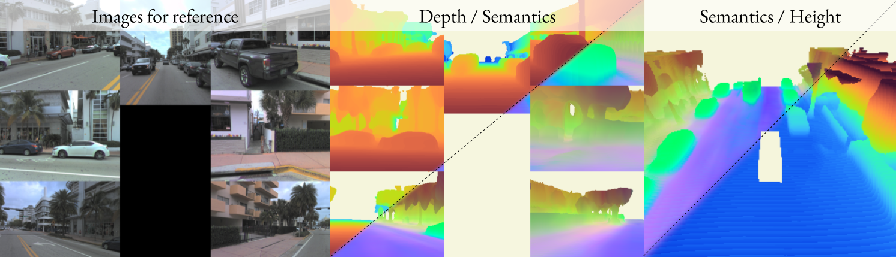

<p align="center">
    <a href="https://research.zenseact.com/publications/gasp/"></a>
    <a href="https://arxiv.org/abs/2503.15672"></a>
    
</p>

<div align="center">
<h1>GASP</h1>
<h3>Unifying Geometric and Semantic Self-Supervised Pre-training for Autonomous Driving</h3>
</div>

<div align="center">
<picture>
    <source media="(prefers-color-scheme: dark)" srcset="docs/_static/imgs/dino-feats.png" />
    
</picture>
</div>

<br>

<div align="center">

[Project Page](https://research.zenseact.com/publications/gasp/) &nbsp;·&nbsp;
[arXiv](https://arxiv.org/abs/2503.15672) &nbsp;·&nbsp;
[Setup](#setup) &nbsp;·&nbsp;
[Data Preparation](#data-preparation) &nbsp;·&nbsp;
[Training](#training) &nbsp;·&nbsp;
[Citation](#citation)

</div>

---

## About

This is the official repository for _GASP: Unifying Geometric and Semantic Self-Supervised Pre-training for Autonomous Driving_, accepted at **WACV 2026**.

Self-supervised pre-training based on next-token prediction has enabled large language models to capture the underlying structure of text, and has led to unprecedented performance on a large array of tasks when applied at scale. Similarly, autonomous driving generates vast amounts of spatiotemporal data, alluding to the possibility of harnessing scale to learn the underlying geometric and semantic structure of the environment and its evolution over time.

We propose a **g**eometric **a**nd **s**emantic self-supervised **p**re-training method, GASP, that learns a unified representation by predicting, at any queried future point in spacetime:
1. **General occupancy** — capturing the evolving structure of the 3D scene
2. **Ego occupancy** — modeling the ego vehicle path through the environment
3. **Distilled vision foundation model features** — high-level semantic features from DINOv2

By modeling geometric and semantic 4D occupancy fields instead of raw sensor measurements, the model learns a structured, generalizable representation of the environment and its evolution through time. We validate GASP on multiple autonomous driving benchmarks, demonstrating significant improvements in semantic occupancy forecasting, online mapping, and ego trajectory prediction.

---

## Setup

### 1. Build the Docker image

From the repository root, run:

```bash
bash docker/build_docker.sh
```

This builds a Docker image tagged `gasp:latest` based on CUDA 11.8 / Ubuntu 22.04, installs all Python and CUDA dependencies, and compiles the custom CUDA extensions.

> **Tip:** To speed up the build, edit `docker/Dockerfile` and remove CUDA architectures in `CUDA_ARCHITECTURES` that do not match your GPU. See [NVIDIA CUDA GPUs](https://developer.nvidia.com/cuda-gpus) for your architecture number.

### 2. Configure environment variables

Copy or create `docker/.env` with your credentials:

```bash
WANDB_API_KEY=your_wandb_key
HF_TOKEN=your_huggingface_token
```

You can also set the paths to your datasets and outputs (defaults shown):

```bash
DATASET_ROOT=/datasets/
DINO_DIR=/dino_features/
OUTPUT_DIR=/outputs/
```

### 3. Start and attach to the container

```bash
# Start the container in the background
./docker/start_docker.sh

# Attach a shell to the running container
./docker/into_docker.sh

# Stop the container when done
./docker/stop_docker.sh
```

To run a one-off command directly (foreground, exits when done):

```bash
./docker/start_docker.sh "python gasp/train.py gasp-av2"
```

---

## Data Preparation

### Argoverse 2

Download the **Argoverse 2 Sensor Dataset** from the [official Argoverse website](https://www.argoverse.org/av2.html).

### DINOv2 Features

GASP predicts distilled DINOv2 features as a pre-training target. There are two ways to provide them:

#### Option A — Pre-compute features (recommended)

Pre-extract and cache **Denoised DINOv2 features** for the full dataset:

```bash
python gasp/scripts/extract_dino_features.py \
    --data-dir /datasets/argoverse2 \
    --output-dir /dino_features/
```

This allows fast dataloading during training by reading cached `.npy` files instead of running the vision encoder on-the-fly.

#### Option B — Compute features on the fly with DINOv3

While not part of the paper, for convinience, features can also be computed on the fly using DINOv3 with optional dimensionality reduction. To generate a pre-computed reduction matrix (recommended for efficiency):

```bash
python gasp/scripts/generate_dinov3_reduction.py \
    --data-dir /datasets/argoverse2 \
    --output-dir /dino_features/
```

Without a reduction matrix, a subset of feature dimensions will be used automatically.

### Missing LiDAR Points

To fill in missing LiDAR points in the dataset:

```bash
python gasp/scripts/extract_missing_points.py \
    --data-dir /datasets/argoverse2
```

---

## Training

Training is launched inside the Docker container via `gasp/train.py`. The script uses a subcommand-based CLI — run with `-h` for help at any level:

```bash
# Top-level help
python gasp/train.py -h

# Help for the GASP pre-training config
python gasp/train.py gasp-av2 -h
```

### GASP pre-training (full — occupancy + ego path + DINO features)

```bash
python gasp/train.py gasp-av2
```

### UNO baseline (occupancy only)

```bash
python gasp/train.py uno-av2
```

Trainer arguments (e.g. number of nodes, batch size) come _before_ the subcommand; model arguments come _after_:

```bash
python gasp/train.py [trainer args] gasp-av2 [model args]
```

---

## Citation

If you find this work useful, please consider citing:

```bibtex
@article{ljungbergh2025gasp,
  title        = {GASP: Unifying Geometric and Semantic Self-Supervised Pre-training for Autonomous Driving},
  author       = {Ljungbergh, William and Lilja, Adam and Tonderski, Adam and Laveno Ling, Arvid and Lindstr{\"o}m, Carl and Verbeke, Willem and Fu, Junsheng and Petersson, Christoffer and Hammarstrand, Lars and Felsberg, Michael},
  journal      = {WACV},
  year         = {2026}
}
```
